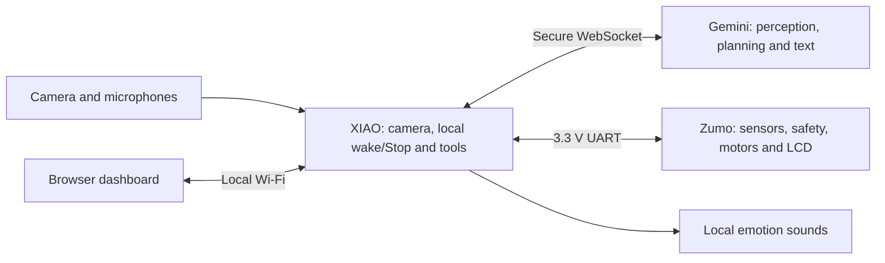

# Digit

Digit is a small tracked robot that sees, listens, and reacts through animated
LCD eyes, electronic emotion sounds, gestures, and short dashboard text updates.
It combines a **Seeed XIAO ESP32-S3 Sense**, a **reSpeaker Flex XVF3800 Circular-4**,
and a **Pololu Zumo 2040 running MicroPython**. A browser dashboard provides live
video, typed chat, manual controls, configuration, and action history.

The XIAO connects directly over Wi-Fi to **Gemini Robotics ER 2**; no PC relay is
needed after setup. Say **Hey Digit**, wait for the wake acknowledgment, then
speak, or type into **Chat with Digit**. Gemini understands audio, images, and
text. Digit replies through emotes and text. **The current firmware does not
produce spoken replies or use TTS.**

During an active session, Gemini receives the newest camera frame **once per
second**, including during reasoning and movement. Uploads are capped at 1 FPS;
transport congestion or unavailable fresh frames can reduce the measured rate.
Old frames are not queued and missed uploads do not cause catch-up bursts.
Standby, End session, STOP ALL, and connection-only tests have camera and
microphone uploads off.

## How the project works



| Component | Responsibility |
| --- | --- |
| XIAO / ESP-IDF | Camera capture, optional local vision overlays, local Hey Digit and Stop models, microphone input, emotion sounds, Wi-Fi, dashboard, and validated Gemini tools. |
| Gemini Robotics ER 2 | Interprets requests and images, chooses supported actions, and returns brief text. It waits for actual tool results before planning another step. |
| Zumo / MicroPython | Encoder/gyro feedback, front distance and floor sensors, braking, bounded recovery, watchdogs, RGB LEDs, and LCD animation. |

Fresh spoken or typed input opens a bounded task. Later input steers that task
without resetting its deadline or movement budget. Starting a session alone
allows observation and spontaneous emotions, but does not authorize navigation.
Gemini must obtain an `observe` result before the first movement. Each movement
returns confirmed rest, measured travel/turn, sensor status, and an image captured
after the movement. `finish_task` ends navigation authority while observation
can continue. End/Stop closes the session; silence does not. The response timeout
setting limits an unresponsive model turn.

Supported tools include observing, gyro turns, measured forward/backward travel,
expressions, dancing, and a bounded forward push. Starting limits are **90° per
turn, 30 cm forward, 10 cm backward, 50 moves, and 90 seconds per task**. Push has
a narrowly scoped close-obstacle exception; edge, feedback, watchdog,
communication, and Stop protections remain active. Zumo handles immediate safety
independently of cloud reasoning. Interrupted motor commands are never replayed.

## What you need

This guide describes this repository's hardware configuration. Different motor
wiring, displays, or microphone geometries require matching drivers/configuration.

| Item | Purpose |
| --- | --- |
| XIAO ESP32-S3 Sense with camera, 8 MB flash and 8 MB PSRAM | Camera, networking, local voice detection, and dashboard. |
| reSpeaker Flex XVF3800 Circular-4, attached XIAO, and compatible speaker | Processed microphone input, direction information, and local sound output. |
| Zumo 2040 with encoders, IMU, floor sensors, and motor supply | Tracked chassis and local control. |
| Front VL53L4CD ToF sensor | Narrow front distance sensing on Zumo I2C. |
| Waveshare 1.69-inch ST7789V2 LCD, 240 × 280 | Face and compatibility display, used in landscape orientation. |
| Suitable power supplies, data USB cables, wiring, and a mount | Assembly, programming, and inter-board connection. |
| 2.4 GHz Wi-Fi with internet and a browser on the same network | Direct cloud connection and local dashboard access. |
| Gemini API key with access to `gemini-robotics-er-2-streaming-preview` | Cloud perception/planning; access and quota depend on your Google project. |

Install Git, VS Code with PlatformIO, and Thonny. Python supports calibration
and optional training utilities. Windows PowerShell and Visual Studio C++ build
tools are needed for the supplied desktop C++ tests; browser tests use Node.js,
Playwright, and Microsoft Edge.

Hardware references: [XIAO guide](https://wiki.seeedstudio.com/xiao_esp32s3_getting_started/),
[reSpeaker Flex guide](https://wiki.seeedstudio.com/respeaker_flex_introduction/), and
[Zumo 2040 guide](https://www.pololu.com/docs/0J87).
Google's [Robotics streaming documentation](https://ai.google.dev/gemini-api/docs/robotics-streaming)
specifies JPEG input at up to 1 FPS, 16 kHz PCM input, and text output for this
model. The ordinary ER 2 endpoint is a different API.

## 1. Get the source

```sh
git clone https://github.com/nazirlouis/digit.git
cd digit
```

Open **`digit/xiao-sense`** as the PlatformIO project and select
**`xiao_esp32s3_sense_idf`**. This is the active ESP-IDF application. The platform
is pinned to `espressif32 @ 6.12.0`; this checkout uses ESP-IDF 5.5. PlatformIO
and the IDF component manager obtain dependencies on the first build.

Deployable vision and wake/Stop models are included: normal setup does not require
training. Training photographs and intermediate runs are not included.

## 2. Assemble and wire the hardware

Power off before wiring. UART uses **3.3 V logic** and needs a shared ground.
Use supplies suitable for each board and follow the manufacturers' power
instructions when combining USB and batteries. The repository does not provide
a regulator circuit.

### XIAO to Zumo UART

| Signal | XIAO | Zumo |
| --- | --- | --- |
| XIAO TX → Zumo RX | D2 / GPIO3 | GP29 / UART0 RX |
| Zumo TX → XIAO RX | D3 / GPIO4 | GP28 / UART0 TX |
| Ground | GND | GND |

The link uses **115200 baud, 8N1**. GPIO43/GPIO44 are used for reSpeaker audio;
the current motor-control link is on D2/D3.

The front ToF and IMU share **Zumo I2C0: GP4 SDA, GP5 SCL**, with the VL53L4CD
at `0x29`. The XIAO/reSpeaker attachment supplies GPIO8 BCLK, GPIO7 WS,
GPIO44 data to reSpeaker, GPIO43 data from reSpeaker, GPIO5 SDA, and GPIO6 SCL.
Those GPIO numbers refer to the XIAO, not the Zumo.

### LCD

| LCD signal | Zumo connection |
| --- | --- |
| VCC and BL | 3V3; BL needs power for a visible backlight |
| GND | GND |
| DIN / MOSI | GP3 |
| CLK / SCK | GP2 |
| CS | GP7 |
| DC | GP0 |
| RST | GP1 |

**Disconnect the “Buzzer = 7” jumper** and install the silent buzzer replacement
before using GP7 as LCD CS. GP28 must remain available for UART. The supplied
display driver releases shared button/LED pins between bounded transfers.
See [Zumo wiring and installation](zumo-controller/README.md).

### reSpeaker firmware

Use **16 kHz, two-channel I2S firmware matching the microphone geometry**.
The included Circular-4 image is
`firmware-tools/respeaker-flex/reSpeaker_Flex-main/xmos_firmwares/i2s/respeaker_flex_i2s_c16k2ch_v1.0.3.bin`.
Follow the [vendor firmware update procedure](https://wiki.seeedstudio.com/respeaker_flex_introduction/)
through the **XMOS USB port**. Use the **XIAO USB port** for the Digit application;
programming one does not program the other. USB-audio and 48 kHz images are not
the embedded configuration expected here.

## 3. Install the Zumo controller

Back up the Zumo first. Use Pololu's Zumo 2040 MicroPython firmware and retain its
`zumo_2040_robot` package; generic RP2040 firmware does not supply that library.
The display requires `framebuf.ellipse()`. Follow the
[Pololu guide](https://www.pololu.com/docs/0J87) for firmware and Thonny setup.
Select the Zumo USB port separately from the XIAO port.

Stop the running program with motor power off. Copy the root modules and library
replacements in [Required device files](zumo-controller/README.md#required-device-files)
to the device, keeping their names. Installing only `main.py` is insufficient.
Save files to the device rather than just running an unsaved editor buffer.
Restart and verify device contents. **XIAO flashing does not update Zumo Python.**

The supplied motor replacement reverses the left motor for this robot's modified
wiring. With factory wiring, retain the matching factory driver instead of blindly
applying that inversion. With both tracks lifted, verify that positive commands
turn both tracks forward and give positive encoder counts. The included
`encoder_calibration.json` belongs to the original robot; measure your own
velocity calibration before relying on powered feedback.

Startup stops the motors, initializes sensors, and calibrates the floor sensors.
Keep Digit stationary on a safe, supported surface. Ordinary edge events use
bounded local recovery; Gemini cannot recalibrate or disable safety gates.
Manual surface calibration is a maintenance action if boot calibration fails.

## 4. Configure Wi-Fi and build the XIAO

Copy `xiao-sense/src/wifi_credentials.example.h` to
`xiao-sense/src/wifi_credentials.h`, then enter your Wi-Fi name and password.
The real credentials file is ignored by Git. From the repository root:

```powershell
Copy-Item xiao-sense/src/wifi_credentials.example.h xiao-sense/src/wifi_credentials.h
```

Build and inspect the complete upload bundle:

```sh
pio run -d xiao-sense -e xiao_esp32s3_sense_idf
pio run -d xiao-sense -e xiao_esp32s3_sense_idf -t check_bundle
```

If `pio` is not on PATH, use PlatformIO's VS Code terminal/build task.
`check_bundle` prints the upload command without executing it. The build packs
the pedestrian and Battery/Marker/Screwdriver models automatically. Local Hey
Digit and Stop models are embedded in the application.

The 8 MB flash holds the application, vision bundle, NVS, and alternating Gemini
instruction slots. Upload the matching bundle, not just the application binary.
Normal uploads preserve settings; whole-flash erasure removes the saved key and
instructions.

## 5. Upload and open the dashboard

Connect a data USB cable to the **XIAO**. The configuration currently names COM7;
set `upload_port` and `monitor_port` to your own port, or specify it explicitly:

```sh
pio run -d xiao-sense -e xiao_esp32s3_sense_idf -t upload --upload-port COM7
pio device monitor -d xiao-sense -e xiao_esp32s3_sense_idf --port COM7 --baud 115200
```

Replace COM7 with the actual XIAO port. For bootloader/upload trouble, follow the
[XIAO guide](https://wiki.seeedstudio.com/xiao_esp32s3_getting_started/).
The serial log prints **`Wi-Fi connected: http://<address>`**. Open that address
on the same network. The dashboard uses port 80 and its MJPEG stream port 81.
Do not assume the example IP in utility scripts is your robot's address.

Check camera, reSpeaker, local wake/Stop, and Zumo readiness. The dashboard has:

- Live video and optional local person/object overlays, off by default.
- The exact **Last sent to Gemini** image.
- Typed chat and short model replies.
- Manual drive, face previews, speaker volume, and **STOP ALL**.
- Session state, sensors, task results, and an **Action Console** with requested
  actions, public explanations, and actual controller outcomes.
- **Personality & behavior**, **Base information**, and **Expression & emotions** editors.

## 6. Configure Gemini without movement

1. Get a key in [Google AI Studio](https://aistudio.google.com/apikey) with access
   to `gemini-robotics-er-2-streaming-preview`. Ordinary ER 2 and older voice-model
   names are not interchangeable with this streaming endpoint.
2. Enter it in **Session setup** and Save. A blank key retains the saved key;
   the dashboard clears the input and never returns the saved value.
3. Keep **Preview robot actions only** enabled initially.
4. Run **Test connection**: microphone, camera upload, sounds, faces, gestures,
   and movement remain off.
5. Run **Test-only stream** to check microphone/image input and dashboard replies.
   Model decisions are permitted; physical tool dispatch remains disabled.
6. Use **End session** or **STOP ALL** to cancel uploads and pending work.
   STOP ALL also replaces the cloud connection with a fresh idle connection.

Save verifies the persisted instruction document. Restore buttons change only
the editors until Save. Settings live on the XIAO and survive normal uploads.
Configure keys only on a trusted network: the local dashboard uses HTTP and
should not be exposed publicly.

See [Gemini setup](xiao-sense/GEMINI_LIVE.md) and
[current ER 2 behavior](docs/GEMINI_ROBOTICS_ER2.md).

## 7. Calibrate and accept powered movement

Complete camera, cloud, display, sensor, and lifted-track checks first. Verify
local Stop, button C, and dashboard cancellation under supervision before
allowing Gemini movement. Start on a clear floor away from edges. Front ToF
cannot see behind Digit or establish clearance for the whole route.

| Calibration | Purpose |
| --- | --- |
| Startup floor calibration | Local floor-sensor baselines learned at Zumo boot. |
| `encoder_calibration.json` | Measured forward/reverse encoder rates for velocity feedback. Included values belong to the original robot. |
| `distance_calibration.json` | Measured counts per physical distance; required for distance-based travel. Never guessed from wheel diameter, images, or another robot. |

For distance calibration, stop on a ruler-marked safe floor, record start counts,
drive straight **manually**, stop completely, then measure actual travel:

```sh
python zumo-controller/tools/calibrate_distance.py start --host http://YOUR_DIGIT_IP
python zumo-controller/tools/calibrate_distance.py finish --host http://YOUR_DIGIT_IP --measured-mm 300
```

Replace the host and **300 with your actual measured millimetres**. This helper
only reads telemetry; it does not drive or install files. It requires fresh
encoder feedback, confirmed rest, positive counts, and at least 100 mm of
measured travel. A Zumo restart invalidates the run. Copy the generated
`zumo-controller/distance_calibration.json` to the Zumo root and restart. Verify
shorter forward/reverse moves and braking before enabling Gemini execution.
This per-robot measurement stays out of Git.

Builds, desktop tests, flashing, and idle telemetry do not prove physical travel,
edge recovery, audible cues, visible faces, or acoustic wake/Stop performance.
See [physical acceptance](docs/TWO_BRAIN_ACCEPTANCE.md) and
[distance calibration](docs/GEMINI_ROBOT_CONTROL.md#distance-calibration-the-final-powered-step).

## Repository map

| Path | Contents |
| --- | --- |
| `xiao-sense/` | Active ESP-IDF/PlatformIO firmware, dashboard, models, and host tests. |
| `zumo-controller/` | MicroPython runtime, library replacements, diagnostics, tests, and face previews. |
| `docs/GEMINI_ROBOTICS_ER2.md` | Current cloud, camera, emote, and Action Console behavior. |
| `docs/TWO_BRAIN_PROTOCOL.md` | Inter-board motion protocol, safety, results, and recovery. |
| `reactions/` and `tools/` | Shared reaction catalog and generation/preview utilities. |
| `model-training/` | Optional training/export/evaluation tools; not needed for installation. |
| `dataset-review/review_v3.py` | Optional dataset review utility. |
| `firmware-tools/respeaker-flex/` | Vendor firmware images and DFU utilities. |
| `zumo-controller/factory-backup/` | Original restoration/reference snapshot; do not overwrite the active Digit controller with it. |

Deployable models and metadata remain included. Datasets, captures, credentials,
flash dumps, environments, build output, and test artifacts remain local and
ignored. Retired prerecorded speech clips, their unused encoder/decoder, and the
inactive OLED adapter have been removed. Procedural emotion sounds, the LCD,
factory restoration files, diagnostics, and safety regressions remain available.

## Development checks

From the repository root on Windows, run the suites relevant to your change:

```powershell
& ./xiao-sense/tests/run_gemini_live.ps1
& ./xiao-sense/tests/run_robot_session.ps1
& ./xiao-sense/tests/run_actions.ps1
& ./xiao-sense/tests/run_local_stop.ps1
python -m unittest discover -s zumo-controller/tests
```

C++ scripts need Visual Studio C++ build tools and PlatformIO's ESP-IDF packages
(build once first). Other focused suites cover settings, camera sharing, memory
bounds, and gesture audio. Browser tests use
`node xiao-sense/tests/test_dashboard.cjs`, `test_gemini_chat.cjs`, and
`test_gemini_instructions.cjs`; make Playwright available to Node first.
`node xiao-sense/tools/preview_dashboard.cjs` creates a device-free preview.
Rebuild and inspect `check_bundle` after firmware changes.

## Troubleshooting

| Symptom | Check |
| --- | --- |
| No dashboard | Wi-Fi credentials, 2.4 GHz network, printed IP, shared network, and port 80. |
| Wrong firmware uploaded | Open `xiao-sense`, select `xiao_esp32s3_sense_idf`, and verify the XIAO USB port. |
| Camera/model failure | Camera attachment, PSRAM startup status, and complete vision-bundle upload. |
| reSpeaker unavailable/wrong rate | Geometry-matched 16 kHz I2S firmware, attachment, I2C `0x2C`, and read-only `/api/audio/processing`. |
| Zumo disconnected | Crossed D2/GP29 and D3/GP28 UART, shared ground, matching modules, and GP28 freed from LCD CS. |
| Blank LCD | 3V3 backlight, GP7 CS/buzzer jumper, silent buzzer replacement, and display driver. |
| Travel unavailable | Floor readiness, fresh ToF/encoder feedback, firmware capabilities, and measured distance calibration. |
| Gemini connection error | Key/model access, quota, internet, clock synchronization, and the redacted connection issue. |
| Camera uploads below 1 FPS | Fresh-frame availability/transport load. Standby, Stop, and connection probes deliberately send no frames. |
| Edge/obstacle stop | Inspect local fault/recovery and Action Console results; resolve the physical cause instead of weakening safety gates. |
